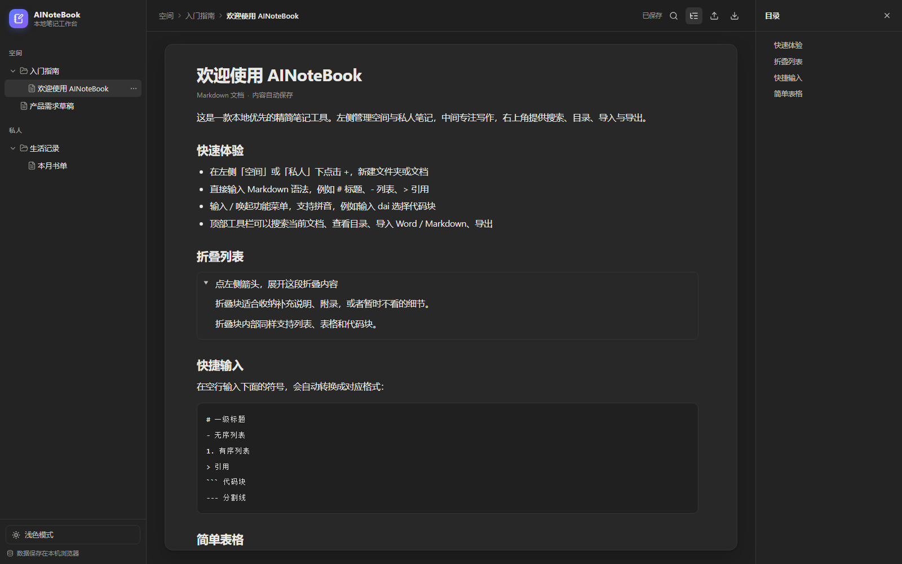
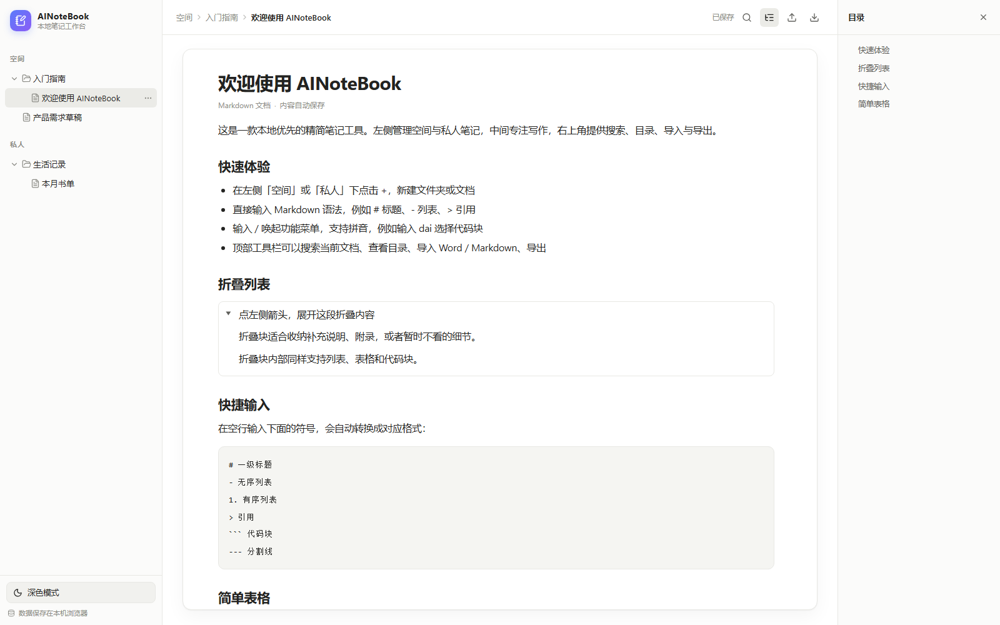

# AINoteBook

[](https://github.com/AIer259/AITOOLS/actions/workflows/ci.yml)
[](../LICENSE)
[](https://nodejs.org/)

本地优先的精简 Markdown 笔记应用。左侧管理「空间 / 私人」文档树，中间专注写作，右侧目录与搜索；支持复杂表格、着重块、代码块语言与语法高亮、图片、嵌套 PDF / Word / Markdown 文档与 PDF 导出。

所有数据保存在浏览器 IndexedDB，没有后端、账号或云同步。

**在线使用**：<https://aier259.github.io/AITOOLS/AINoteBook/>（线上版与本地开发版数据独立）

> 本目录是 [AITOOLS](../README.md) 仓库中的 AINoteBook 项目。

| 深色模式 | 浅色模式 |
| :---: | :---: |
|  |  |

## 目录

- [功能](#功能)
- [快速开始](#快速开始)
- [使用提示](#使用提示)
- [导出](#导出)
- [数据与隐私](#数据与隐私)
- [技术栈](#技术栈)
- [项目结构](#项目结构)
- [可用脚本](#可用脚本)
- [端到端自测](#端到端自测)
- [已知限制](#已知限制)
- [贡献](#贡献)
- [许可证](#许可证)

## 功能

- **空间 / 私人分区**：两个分区下都可以新建文件夹或文档，支持重命名、删除后移入回收站、展开收起。
- **拖拽整理**：左侧可把文档 / 文件夹拖到目标文件夹或区域标题（区域根目录）；拖动主文件时附件文件夹同步移动；附件文件夹及其中的文档不能单独拖拽；目标已有同名附件文件夹时会阻止移动。
- **回收站**：左侧底栏显示入口与数量；删除的文档 / 文件夹先移入回收站，可单独恢复或永久删除；恢复主文档时附件文件夹一并恢复；附件文件夹只能随主文档处理；清空回收站需输入「确认清空回收站」。
- **备份与提醒**：顶栏右上角备份菜单中的「导出全部笔记」导出完整 ZIP；启动时若从未备份、超过 30 天或文档数变化 ≥10 篇，显示非阻塞提醒，可 7 天后再提醒或不再提醒。ZIP 含所有活动文档 Markdown、原始编辑器 JSON、图片、附件文件夹、PDF/Word 原文件与 manifest，不含回收站。
- **合并恢复**：顶栏备份菜单中的「从备份恢复」选择备份 ZIP；恢复内容分别进入各分区新建的「备份恢复 &lt;时间&gt;」文件夹，现有笔记不受影响；原始 JSON 经 ID 重映射后写回，图片、附件与 PDF/Word 一并恢复。
- **本地自动保存**：内容写入浏览器 IndexedDB，输入后自动保存，刷新不丢失。
- **Markdown 写作**：标题（H1–H5）、列表、待办、引用、代码块、分割线、表格、粗体斜体删除线、行内代码。
- **代码块语言**：点击代码块右上角语言名称，可按名称、短名或中文别名搜索（如 `js`、`py`、`纯文本`）；选择后按语言语法高亮，并保留到 Markdown 围栏与 PDF / 打印导出。头部左侧可给代码块命名，右侧「复制」一键复制代码内容。
- **复杂表格**：输入 `/f`、`/fz` 或 `/biaoge` 插入；悬停右侧 / 底部 / 右下角可加列、加行或同时加行列；点入表格右上角工具条可删行、删列、删整表；在目标单元格右键也可精确删除；支持自适应列宽与拖动列分隔线，表格始终占满正文宽度。
- **着重块**：输入 `/着重`、`/zhuozhong` 或 `/zzk` 插入带 💡 图标的边框块，图标固定在左上角。
- **工作区浏览**：点击左侧「空间 / 私人」或文件夹，中栏展示其下的文件夹与文档；顶部面包屑可点击返回上级区域或文件夹。
- **固定纸张 + 内部滚动**：中栏纸张最大宽度 1100px，高度固定为窗口可用高度；标题与元信息常驻，正文独立滚动。
- **单位块写作**：每一段是一个单位块；`Enter` 新建单位块，`Shift+Enter` 在当前块内换行；点击正文下方空白区会自动追加并聚焦。
- **图片**：粘贴或拖入图片即可显示；SHA-256 内容哈希自动去重；图片二进制保存在 IndexedDB；悬停手型，第一次点击出现放大镜，第二次点击全屏查看。
- **资源管理**：启动时申请持久化存储并显示本机存储用量；移入回收站不清理图片，永久删除后才由 mark-sweep 在宽限期后清理未引用图片。
- **折叠列表**：左侧箭头展开 / 收起，内部可放列表、表格、代码块。
- **斜杠命令**：输入 `/` 唤起，支持中文、英文、全拼与首字母匹配；`↑` `↓` 选择，`Enter` 执行，`Esc` 关闭。
- **可嵌套文档**：通过 `/嵌入文档` 选择已有笔记，或上传 Markdown / PDF / Word（.md / .markdown / .pdf / .docx）；被嵌入的文件会自动放入主笔记同级的「<主文件名>附件」文件夹，附件文件夹默认折叠，卡片展开后就地预览；删除主文件时附件文件夹一起移入回收站。
- **选区格式工具条**：拖拽选中文字后，上方出现加粗、斜体、下划线、链接、着色按钮；着色面板提供 `Text Color` 与 `Background Color` 预设颜色、无颜色和自定义调色盘。
- **链接工具**：鼠标悬停链接显示地址卡片，可复制链接或打开编辑弹窗；弹窗支持修改 URL 与链接标题，也可删除链接但保留文字。
- **文档内搜索**：高亮全部命中，显示 `n/m`，`Enter` 下一处、`Shift+Enter` 上一处。
- **目录面板**：从标题实时生成，按层级展示；默认只显示一、二级，三级及之后折叠，可手动逐级展开；点击标题跳转到对应位置。
- **导入**：Markdown（.md / .markdown，含 data URI 图片）、Markdown + 图片 ZIP（含附件文件夹）、Word（.docx），均转换为可编辑笔记。
- **导出**：Markdown 单文件 / ZIP（ZIP 含图片与嵌入附件），PDF 直接下载 / 浏览器打印。
- **双主题**：浅色（白外壳 + 白纸张）/ 深色（浅黑外壳 + 浅黑纸张），自动记忆选择。

## 快速开始

需要 Node.js 20 及以上。

```bash
git clone https://github.com/AIer259/AITOOLS.git
cd AITOOLS/AINoteBook
npm ci
npm run dev
```

打开 <http://localhost:5174>。

开发端口固定为 5174 并启用 `strictPort`。如需同时运行第二个实例（例如自动化测试）：

```bash
npm run dev -- --port 5173
```

不同端口对应不同的浏览器源，IndexedDB 数据互不共享。

生产构建：

```bash
npm run build
npm run preview
```

## 在线更新

线上版启动后会读取同源的 `AINoteBook/version.json`，与当前构建版本比较：

- 发现新版本时弹窗显示当前版本与最新版本；选择「立即更新」会重新加载页面，加载最新构建；选择「稍后」在本次会话内不再提示。
- 更新只刷新页面，不会清空或迁移 IndexedDB 中的笔记。
- `npm run dev` 本地开发版不执行检测，避免反复弹窗；本地代码更新仍使用 `git pull`。
- 线上版与 `http://localhost:5174` 属于不同浏览器源，数据互不共享。

## 使用提示

| 操作 | 方式 |
| --- | --- |
| 新建文档 / 文件夹 | 左侧「空间」或「私人」标题旁的 `+`；文件夹行悬停也有 `+` |
| 重命名 / 删除 | 节点行悬停 `…` 菜单；删除文档时会连同附件文件夹移入回收站 |
| 回收站 | 左侧底栏「回收站」入口；可恢复或永久删除单项；清空需输入「确认清空回收站」 |
| 导出全部笔记 | 顶栏右上角备份图标 →「导出全部笔记」；导出完整备份 ZIP，启动时按备份时间与文档数变化提醒 |
| 从备份恢复 | 顶栏备份图标 →「从备份恢复」；选择备份 ZIP 后合并到各分区新建的「备份恢复 &lt;时间&gt;」文件夹 |
| 移动文档 / 文件夹 | 在左侧拖到目标文件夹，或拖到「空间 / 私人」标题移动到区域根目录 |
| 点击空白处继续写 | 点击正文下方空白区，自动在末尾追加单位块并聚焦 |
| 新建 / 扩展单位块 | `Enter` 新建块；`Shift+Enter` 在当前块内换行 |
| 插入标题 | 空行输入 `/h1` 到 `/h5`，或 `/bt4`、`/bt5` 等拼音；也支持 Markdown `#` 到 `#####` |
| 插入图片 | 直接粘贴截图或拖入图片文件 |
| 选区格式 | 拖拽选中文字，在浮层中点加粗 / 斜体 / 下划线 / 链接 / 着色；着色面板可设文字颜色与背景色 |
| 插入着重块 | 空行输入 `/着重`、`/zhuozhong` 或 `/zzk` |
| 插入复杂表格 | 空行输入 `/f`、`/fz` 或 `/biaoge` |
| 设置代码块语言 | 点击代码块右上角语言名称，搜索并选择；`Plain Text` 关闭语法高亮 |
| 命名 / 复制代码块 | 头部左侧输入名称（仅编辑器显示，不进入导出）；右侧「复制」复制代码内容 |
| 表格加列 / 加行 | 悬停表格右边缘 / 下边缘的 `+`；右下角小 `+` 同时加行列 |
| 删除行 / 列 / 整表 | 点入表格后右上角工具条「删行 / 删列 / 删表」，或在目标单元格右键选择；`Ctrl+Z` 可撤销 |
| 表格自适应 / 列宽 | 点入表格后右上角「自适应」；拖动列分隔线调整相邻列宽 |
| 查看大图 | 第一次点击图片出现放大镜，第二次点击全屏；`Esc` 或点背景关闭 |
| 复制 / 修改链接 | 悬停链接后点击卡片里的复制或修改；修改弹窗内可改地址与标题，左下角「删除链接」保留文字 |
| 唤起功能菜单 | 空行输入 `/`，继续输入中文、英文或拼音过滤 |
| 嵌入文档 | `/embed` → 选择文档，或在弹窗中上传 Markdown / PDF / Word |
| 打开 PDF / Word 文件 | 从左侧文件树点击，右侧显示只读预览 |
| 搜索当前文档 | 顶栏放大镜 |
| 目录 | 顶栏目录按钮展开右侧面板；默认只显示一、二级，三级及之后折叠；点击标题左侧箭头逐级展开，点击标题文字跳转 |
| 目录折叠状态 | 切换笔记或刷新后重置为默认层级 |
| 导入 / 导出 | 顶栏上传 / 下载图标 |
| 跨设备导入带图片笔记 | 顶栏上传 → 选择「Markdown + 图片（ZIP）」 |
| 浏览区域 / 文件夹 | 点击左侧「空间 / 私人」标题或文件夹行，中栏显示其下内容 |
| 返回上级目录 | 点击顶部面包屑中的区域名或文件夹名 |
| 切换主题 | 左下角按钮 |

## 导出

Markdown：

- **单文件**：图片内嵌为 data URI，一个 `.md` 即可分享；图片多时文件会明显变大。
- **ZIP**：`.md` + 真实 `assets/photos/<当前笔记名>/` 图片目录 + `<主文件名>附件/` 嵌入文件目录，适合保留目录结构并跨设备恢复嵌入文档。

PDF：

- **直接下载**：html2canvas + jsPDF 分页绘制，生成较快，但文字是图片，不可检索。
- **浏览器打印**：打开打印窗口后选择「另存为 PDF」，文字为矢量、清晰且可检索。
- 两种 PDF 导出都会把折叠列表按展开状态输出，避免打印时只剩标题。

着重块在 Markdown 中导出为 `> 💡` 引用块；代码块在 Markdown 中保留语言围栏（如 ```` ```python ````），PDF / 打印中保留语言标识与语法高亮；文字颜色与背景色在 PDF / 打印中保留，Markdown 不保留；表格列宽在 PDF / 打印中保留，Markdown 使用 GFM 表格语法、不保留列宽。

## 数据与隐私

- 文档树元数据：IndexedDB（`ainb.tree.v2`，含 `order`、`attachmentFolderId`、`ownerDocId`）
- Markdown 正文：IndexedDB（`ainb.node.<id>`，每个文档独立键）
- PDF / Word 原始文件：IndexedDB（`ainb.blob.*`）
- 图片资源：IndexedDB（`ainb.assets.meta` 元数据 + `ainb.asset.<sha256>` 二进制）
- 当前文档、主题：localStorage
- 更新提示的「稍后」记录：sessionStorage（会话级，关闭标签页后失效）
- 启动时尝试申请持久化存储；左下角显示已用容量 / 配额与持久化状态
- 没有后端、账号与云同步；清除浏览器站点数据会丢失全部笔记与图片，请用导出功能备份

## 数据模型

- `ainb.tree.v2`：树元数据数组；节点含 fractional-index `order`，文档含 `attachmentFolderId`，附件文件夹含 `ownerDocId`；移入回收站的节点带 `deletedAt`，正文与 blob 保持原样
- `ainb.node.<id>`：Markdown 正文 JSON，按需读取，树保存不再重写全部正文
- `ainb.blob.<id>`：PDF / Word 原始文件
- `localStorage` 的 `ainb.backup.v1`：上次备份时间、备份时文档数、忽略标记与 7 天 snooze；不存笔记内容
- 首次加载会自动把旧 `ainb.tree.v1` 的正文拆分到独立键，并补齐附件显式关系；v1 保留作为迁移备份

## 技术栈

React 19 · TypeScript · Vite 8 · Tiptap 3（ProseMirror）· lowlight / highlight.js · Zustand · IndexedDB（idb-keyval）· marked · turndown · mammoth · html2canvas · jsPDF · JSZip · lucide-react

## 架构分层

- `domain/`：纯领域命令，接收数据、返回结果，不依赖 store、React、IndexedDB
- `application/`：用例/命令，依赖 `NoteRepository` 接口，不直接 import Zustand / React
- `lib/`：IndexedDB、文件解析、导出渲染、图片资源等基础设施与纯工具
- `lib/treeIndex.ts`：从 `nodes` 派生的只读索引（按引用缓存），提供 O(1) 节点 / 子节点 / 附件查找与 O(子树) 回收站整包；交互路径通过 `useTreeIndex()` / `getTreeIndex()` 读取，不再反复 `filter` / `find`
- `store/`：Zustand 适配器，负责状态读写、持久化与用例编排
- `components/` / `extensions/`：界面与 Tiptap 交互，负责 toast 等 UI 反馈

`npm run check:arch` 会检查依赖方向，禁止 `lib -> store`、`store -> components` 等反向依赖。

## 项目结构

```text
AITOOLS/
├─ AINoteBook/
│  ├─ src/
│  │  ├─ components/     # 侧栏、编辑器、目录、通用弹窗
│  │  ├─ extensions/     # Tiptap 节点与插件（表格、着重块、代码块、图片、嵌入）
│  │  ├─ domain/         # 纯领域命令：树操作、附件规划
│  │  ├─ application/    # 用例：导入、上传、NoteRepository 接口
│  │  ├─ lib/            # 基础设施：存储、解析、导出、资源
│  │  ├─ store/          # Zustand 适配器与 UI 状态
│  │  ├─ styles/         # 全局与编辑器样式
│  │  └─ types/          # 类型声明
│  ├─ scripts/           # Puppeteer 端到端自测
│  ├─ docs/screenshots/  # README 截图
│  ├─ public/            # 静态资源
│  ├─ vite.config.ts
│  ├─ vite.pages.config.ts
│  ├─ CHANGELOG.md
│  ├─ CONTRIBUTING.md
│  └─ package.json
├─ site/                 # 工具集合站首页
├─ .github/              # CI、Issue / PR 模板、Pages 部署
├─ CONTRIBUTING.md
├─ LICENSE
└─ README.md             # AITOOLS 工具索引
```

## 可用脚本

| 命令 | 说明 |
| --- | --- |
| `npm run dev` | 启动开发服务器，默认 <http://localhost:5174> |
| `npm run build` | TypeScript 类型检查 + 生产构建 |
| `npm run build:pages` | 以 `/AITOOLS/AINoteBook/` 为 base 构建 GitHub Pages 版本 |
| `npm run typecheck` | 仅执行 TypeScript 类型检查 |
| `npm run check:arch` | 检查 domain/application/lib/store 的依赖方向 |
| `npm run check` | CI 使用的类型检查 + 架构守卫 + 构建 |
| `npm run preview` | 预览生产构建 |

## 端到端自测

仓库内的 `scripts/check-*.mjs` 覆盖五个阶段、中栏布局、图片、着重块、复杂表格与代码块语言。需要本机 Chrome，并临时安装 Puppeteer：

```bash
npm install --no-save puppeteer-core
npm run dev -- --port 5173
node scripts/check-stage1.mjs
# 依次运行 check-stage2 ~ check-stage5
node scripts/check-note-layout.mjs
node scripts/check-image.mjs
node scripts/check-callout.mjs
node scripts/check-table.mjs
node scripts/check-codeblock.mjs
node scripts/check-link.mjs
node scripts/check-toolbar.mjs
node scripts/check-toc.mjs
```

更新检测使用生产构建预览：

```bash
npm run build
npm run preview -- --port 4173
node scripts/check-update.mjs
```

脚本目前按 Windows 本地环境配置 Chrome 路径与 5173 端口；其他系统请修改脚本顶部的 `CHROME` 与 `URL`，或为 `check-codeblock.mjs` / `check-link.mjs` / `check-toolbar.mjs` / `check-toc.mjs` / `check-update.mjs` / `check-trash.mjs` / `check-backup.mjs` 设置 `APP_URL` / `CHROME_PATH` 环境变量（`check-trash.mjs` / `check-backup.mjs` 还支持 `CDP_PORT`）。自测会产生 `.tmp-*` 临时目录，可直接删除。CI 仅执行类型检查与构建，不运行浏览器自测。

## 已知限制

### 存储与资源

- 图片保存在浏览器 IndexedDB，不会写入项目根目录的 `assets/photos`；该路径只作为虚拟路径与 ZIP 导出目录。
- 粘贴 / 拖入的图片文件可保存；从网页复制的纯图片 URL 形式可能不会自动下载保存。
- 移入回收站不会清理图片；永久删除后才在 7 天宽限期后清理未引用图片。
- 回收站不会自动清理，已删除内容会一直占用本机存储，需要手动清空。
- 线上版与本地开发版的浏览器存储按源隔离，笔记不互通；迁移请使用备份 ZIP 或 Markdown 导出/导入。

### 备份与恢复

- 浏览器持久化只能降低站点数据被自动清理的概率，不能替代备份；建议定期使用顶栏备份菜单导出 ZIP。
- 备份为手动下载 ZIP，不会自动上传云端。
- 备份提醒只在应用启动时判断；变更较多以活动文档数变化 ≥10 篇为代理，只修改正文、不增删文档不会触发提醒。
- 备份只包含活动笔记，不含回收站；图片只导出被活动笔记引用的资源。
- 备份记录保存在 `localStorage` 的 `ainb.backup.v1`；清除站点数据会连同记录一起丢失。
- ZIP 在浏览器内存中生成，笔记与图片很多时导出耗时会增加，并可能受本机内存限制。
- 恢复只支持本应用导出的 `ainoteBook-backup` v1 格式；手工修改 manifest 或使用第三方 ZIP 可能只恢复部分内容。
- 恢复采用合并模式，不覆盖现有笔记；重复恢复同一备份会得到多份副本。
- 恢复会为所有备份节点生成新 ID，并重映射父子、附件与嵌入文档关系；恢复的图片若本机已有同 ID 资源会复用。
- 备份不含回收站，因此恢复也不会还原回收站内容。

### 导出与格式

- 单文件 Markdown 会把图片内嵌为 data URI，图片多时文件很大；需要真实图片目录请用 ZIP 导出。
- 表格列宽以百分比保存在文档 JSON 中；Markdown 不保留列宽；合并单元格拖动时按逻辑列调整。
- Word 仅支持 `.docx`，不支持旧版 `.doc`；复杂排版会被简化。
- PDF 预览依赖浏览器内置 PDF 阅读器（推荐 Chrome / Edge）。
- 嵌入文档会随 Markdown ZIP 一起导出/导入；单文件 Markdown 与 PDF 中仍显示为说明卡片，不会展开完整内容。
- 附件文件夹名按嵌入时的主文件名生成，之后重命名主笔记不会自动改名。
- 同名主文档仍可能共用同一个附件文件夹；删除时会避开仍被其他活动文档引用的附件文件夹，但 `ownerDocId` 只能指向其中一个主文档。
- 直接下载的 PDF 为图片型，文字不可检索；分页会避开文字行、表格行、图片与代码块边界，部分页面底部可能留白。
- 自动链接只识别以 `http://`、`https://` 或 `www.` 开头的明确网址；裸域名（如 `example.com`）不会自动链接，避免文件名被误判。
- 暂不支持多人协作与版本历史。

## 贡献

欢迎提交 Issue 或 PR。开发、自测与提交约定见 [CONTRIBUTING.md](CONTRIBUTING.md)；仓库级规则见 [AITOOLS CONTRIBUTING](../CONTRIBUTING.md)；版本变更见 [CHANGELOG.md](CHANGELOG.md)。

## 许可证

[MIT License](../LICENSE) © 2026 AIer259

如果这个项目对你有帮助，欢迎点一个 Star。
